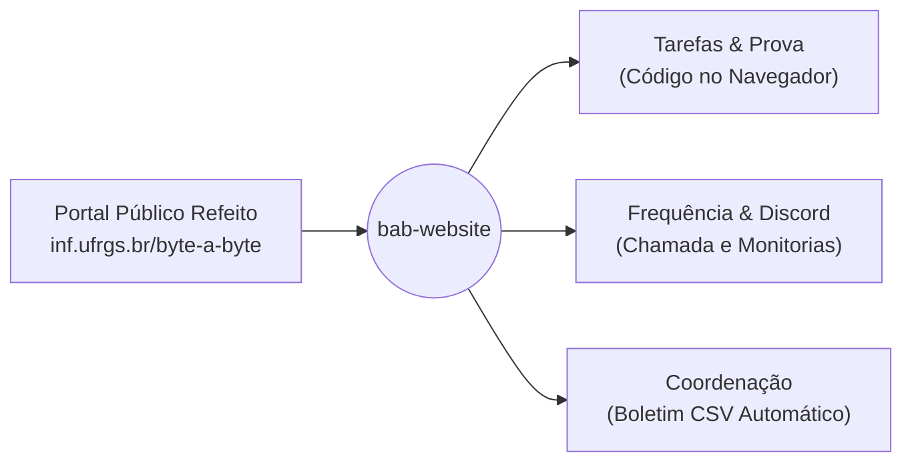

# Byte-a-Byte 2.0
### Uma Plataforma Integrada de Ensino de Programação

**Proposta de Modernização e Ecossistema Digital Unificado**  
Instituto de Informática — UFRGS

**Apresentador:** Adriel de Souza  
*Monitor do Byte-a-Byte & Estudante de Ciência da Computação (INF/UFRGS)*

---

## Quem sou eu?

* **Estudante de Ciência da Computação** na UFRGS (INF).
* **Monitor do Byte-a-Byte**: acompanhando as aulas, dúvidas no Discord e a rotina real dos nossos alunos.
* **Ex-bolsista do Programa Adote um Aluno** (*Fundo Amanhã / Amanhã Tech*) — conheço em primeira mão o poder transformador de aprender a programar do zero.
* **Desenvolvedor na Apple Developer Academy (PUCRS)** & participante da **WWDC26** no Apple Park.
* **Experiência prévia no INF-UFRGS** em desenvolvimento de plataformas institucionais e interfaces web.

> *"O que mais me move é usar a engenharia de software para transformar processos burocráticos e complexos em experiências simples, acolhedoras e de alto impacto social."*

---

## O Byte-a-Byte Hoje

* **Missão Nobre**: Ensinar os primeiros passos em programação (Python) para quem está começando do zero.
* **Estrutura do Curso**:
  * Módulos de Aula (apresentação dos conceitos fundamentais).
  * Semanas de Monitoria no **Discord** (apoio individualizado e resolução de exercícios).
  * Prova Final (avaliação de encerramento).
* **Presença Institucional**:
  * Já temos nossa landing page oficial no ar em [inf.ufrgs.br/byte-a-byte](https://www.inf.ufrgs.br/byte-a-byte/).
* **Porém, por trás dos bastidores da operação pedagógica, enfrentamos gargalos importantes.**

---

## O Diagnóstico: Onde Dói no Modelo Atual?

### 1. Plataforma Externa em Inglês
* A ferramenta atual de exercícios é em **inglês**, gerando uma barreira imediata de intimidação para quem nunca viu código na vida.

### 2. Falta de Controle & Autenticação Externa
* O sistema é de terceiros (caixa-preta). O aluno precisa criar contas externas com usernames que não batem com a matrícula da UFRGS, gerando trabalho manual exaustivo para validar envios.

### 3. Dispersão de Ferramentas (Sistemas Isolados)
* Plataforma de código $\neq$ **Google Sheets** para chamada das aulas $\neq$ planilhas avulsas para monitorias $\neq$ Discord para atendimento.
* **Resultado:** Sobrecarga no aluno e fechamento manual caótico para a coordenação no final do semestre.

---

## A Proposta: Tudo em um Só Lugar (`bab-website`)

Centralizar todo o ecossistema do Byte-a-Byte em uma **plataforma própria, 100% em português e acolhedora**:

* **Zero Instalação**: O aluno programa no navegador desde a primeira aula.
* **Zero Custo de Servidor**: Execução de código via WebAssembly (Pyodide) direto na máquina do aluno.
* **Autenticação Nativa**: Cada aluno já entra com seu login vinculado à turma, sem plataformas externas.

---

## Jornada Pedagógica Humanizada

### 1. Tarefas Semanais (Formativo — Sem Nota)
* Listas com **exercícios práticos de código** e **questões conceituais objetivas**.
* **Tentativas livres e ilimitadas**: o aluno pode errar sem medo, testar hipóteses e fixar o conteúdo.
* Métrica simples: indicador de conclusão (*X de Y concluídas*).

### 2. Prova Final (Somativo — Com Nota)
* Acesso liberado pelo coordenador na data prevista.
* Questões mistas (objetivas + código) com correção automatizada contra casos de teste.
* Cronômetro e salvamento automático contínuo de rascunhos.

---

## Monitorias & Frequência Sem Malabarismo

Eliminamos a necessidade de Google Sheets e planilhas avulsas:

* **Calendário & Escala de Monitorias**:
  * Grade visual no site mostrando **qual monitor estará disponível no Discord em cada dia e faixa de horário**.
  * Alunos sabem exatamente quando entrar para tirar dúvidas.
* **Registro Simples de Monitoria**:
  * O monitor entra no site e marca com 1 clique quem compareceu no Discord;
  * **Ou** assinala *"Nenhum aluno compareceu nesta sessão"* (comprovando seu plantão de atendimento).
* **Chamada Rápida de Aulas**:
  * Coordenador realiza a presença da aula em segundos direto pela lista da turma.

---

## Painel da Coordenação: Fechamento em 1 Clique

* **Matrícula em Lote**: Importação de alunos colando lista de e-mails ou subindo arquivo CSV.
* **Reaproveitamento de Conteúdo**: Construtor de questões com opção de clonar exercícios e provas de turmas anteriores.
* **Boletim Consolidado Automático**:
  * Tabela unificada: Aluno $\times$ Frequência em Aulas $\times$ Atendimentos em Monitorias $\times$ Tarefas Concluídas $\times$ Nota da Prova.
* **Exportação CSV**: Relatório final pronto com um clique para submissão aos sistemas oficiais da UFRGS.

---

## Roadmap de Execução (4 Fases Claras)

| Fase | Foco | Entregáveis Principais |
| :--- | :--- | :--- |
| **Fase 1** | **Fundação & Portal** | • Modernização da Landing Page institucional. • Autenticação unificada (Aluno, Monitor, Coordenador). • Gestão de turmas e importação CSV de alunos. |
| **Fase 2** | **Escala & Frequência** | • Gestão de monitores e calendário visual de horários no Discord. • Registro simplificado de monitorias (com opção de plantão vazio). • Chamada rápida das aulas presenciais. |
| **Fase 3** | **Prática de Código** | • Editor e executor de Python no navegador (sem custo de servidor). • Tarefas semanais formativas (código + questões objetivas). |
| **Fase 4** | **Prova & Boletim** | • Módulo de Prova Final com nota e cronômetro. • Boletim consolidado e exportação de CSV. |

---

## Pauta de TI: Alinhamento com a Rede do INF

Precisamos definir com a administração de redes do Instituto de Informática o modelo de hospedagem da aplicação:

* **Cenário A — Infraestrutura Interna do INF**:
  * Verificar homologação para **Node.js / Docker**, ou servidores tradicionais (**PHP/Apache** ou **Python**).
  * Provisionamento de banco de dados institucional (PostgreSQL / MySQL).
* **Cenário B — Nuvem Externa com Apontamento Institucional**:
  * Hospedar a plataforma em serviços de nuvem gratuitos (**Vercel + Supabase/Neon**).
  * Solicitar à TI do INF apenas o apontamento de DNS (ex: `byte-a-byte.inf.ufrgs.br` ou proxy reverso no nginx existente).

---

## Próximos Passos & Discussão

1. **Validação da Proposta**: Alinhamento com os coordenadores e professores presentes.
2. **Contato com a TI do INF**: Agendar a consulta formal sobre a infraestrutura de hospedagem.
3. **Início do Desenvolvimento**: Configuração da Fase 1 no repositório `bab-website`.

---

<!-- _class: lead -->
# Muito Obrigado!

### Vamos abrir para comentários, dúvidas e alinhamentos?

**Adriel de Souza**  
*Byte-a-Byte — Instituto de Informática / UFRGS*  
[github.com/byte-a-byte-inf/bab-website](https://github.com/byte-a-byte-inf/bab-website)
