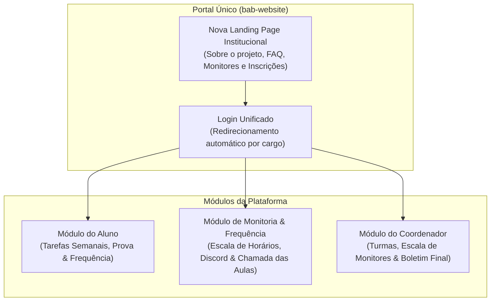
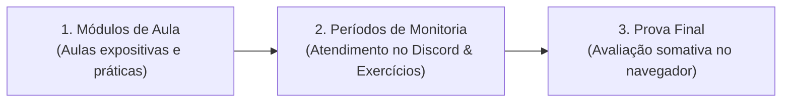

# Proposta de Plataforma Integrada — Byte-a-Byte

---

## 1. Sumário Executivo & Visão do Projeto

O **Byte-a-Byte** é um projeto de ensino introdutório de programação em Python desenvolvido no **Instituto de Informática da UFRGS (INF-UFRGS)**.

A presente proposta unifica o ecossistema digital do projeto dentro do repositório **`bab-website`**:
1. **Refatoração da Landing Page Oficial**: Modernizar a página institucional ([inf.ufrgs.br/byte-a-byte](https://www.inf.ufrgs.br/byte-a-byte/)), servindo como portal público e porta de entrada para a plataforma.
2. **Ambiente de Aprendizagem & Prática**: Permitir que os alunos resolvam exercícios semanais e realizem a prova diretamente no navegador sem necessidade de instalação local.
3. **Escala e Registro de Monitorias**: Gestão de horários e escala de monitores, com registro simplificado dos atendimentos realizados no Discord.
4. **Controle de Presença nas Aulas**: Chamada ágil das aulas para controle de frequência.
5. **Gestão Pedagógica Centralizada**: Acompanhamento de turmas, importação de alunos e emissão do boletim consolidado para a coordenação.

---

## 2. A Dinâmica do Curso

A dinâmica pedagógica do Byte-a-Byte organiza-se em ciclos semestrais divididos em três etapas:

* **Módulos de Aula**: Encontros dedicados à apresentação dos fundamentos de programação (tradicionalmente aos sábados, mas com calendário parametrizável no sistema).
* **Monitorias no Discord**: Plantões de atendimento ao longo da semana, organizados em uma escala de horários em que cada monitor fica disponível para tirar dúvidas e orientar a resolução dos exercícios.
* **Tarefas Semanais (Prática Formativa)**: Listas de exercícios sem nota, incentivando a prática livre e a experimentação sem medo de errar.
* **Prova Final (Avaliação Somativa)**: Único momento com pontuação e nota calculada, realizado no encerramento da turma.

---

## 3. Cargos e Papéis na Plataforma

### 3.1. Coordenador
* **Gestão da Turma**: Cadastra o período letivo, o cronograma das aulas, os períodos de tarefas e a data da prova final.
* **Gestão da Equipe de Monitores**: Cadastra os monitores da turma e define a **escala de horários de monitoria** (qual monitor atende em cada dia e faixa de horário no Discord).
* **Matrícula de Alunos**: Adiciona estudantes individualmente ou importa turmas inteiras via lista/CSV em um clique.
* **Chamada das Aulas**: Realiza a chamada das aulas presenciais diretamente em uma lista visual simples.
* **Banco de Exercícios e Prova**: Cria e edita as atividades em formato misto (**questões práticas de código** e **questões objetivas de múltipla escolha**), com funcionalidade de clonar/duplicar de semestres anteriores.
* **Boletim e Fechamento**: Acompanha o desempenho geral e exporta a planilha final (Nota da Prova + % de Frequência em Aulas + Atendimentos de Monitoria) em formato CSV.

### 3.2. Monitor
* **Calendário e Escala de Monitorias**: Consulta sua escala de horários de atendimento e a dos demais colegas monitores.
* **Atendimento no Discord**: Conduz as sessões de monitoria nas salas de voz e texto do servidor do Discord.
* **Registro Simples de Atendimento**: Acessa a plataforma após o plantão e:
  * Marca na lista os alunos que compareceram para tirar dúvidas; **OU**
  * Assinala a opção *"Nenhum aluno compareceu nesta sessão"* (garantindo o registro formal de disponibilidade do monitor no seu horário).
* **Acesso às Listas da Semana**: Consulta os exercícios propostos para orientar os alunos nas resoluções.

### 3.3. Aluno
* **Visão Central da Turma**: Acompanha o calendário de aulas, prazos das tarefas e a data da prova.
* **Calendário de Monitorias**: Consulta quais monitores estarão disponíveis no Discord em cada dia e horário da semana para planejar suas dúvidas.
* **Tarefas Semanais no Navegador**: Resolve os exercícios práticos com avaliador de código integrado e feedback instantâneo.
* **Realização da Prova Final**: Resolve a avaliação oficial no sistema com cronômetro e salvamento automático.
* **Extrato de Frequência**: Visualiza seu percentual de presença nas aulas e seu histórico de participação nas monitorias.

---

## 4. Módulos do Sistema

### Módulo 1: Portal Institucional & Nova Landing Page
* **Modernização do [inf.ufrgs.br/byte-a-byte](https://www.inf.ufrgs.br/byte-a-byte/)**:
  * Nova landing page integrada ao projeto, mantendo as seções consagradas: *O que é o Byte a Byte*, *Metodologia das Aulas*, *Monitores*, *Quem Somos*, *FAQ* e *Chamada para Inscrições*.
  * Interface moderna, limpa, acessível e responsiva para computador e celular.
* **Área de Acesso Seguro**: Ponto de entrada unificado para login, encaminhando cada usuário diretamente ao seu painel correspondente (Coordenador, Monitor ou Aluno).

---

### Módulo 2: Ambiente do Aluno (Prática & Prova)

#### 1. Tarefas Semanais (Prática Formativa — Sem Nota)
* Listas de exercícios semanais focadas em fixação e consolidação do conteúdo de cada aula.
* Formato misto de atividades:
  * **Questões Objetivas**: Perguntas teóricas de múltipla escolha ou verdadeiro/falso com correção imediata para validação conceitual.
  * **Exercícios Práticos de Código**: Problemas de programação com **avaliador de código Python integrado** direto no navegador (sem instalar nada), com testes de exemplo e diagnósticos em tempo real.
* Tentativas livres e ilimitadas dentro do prazo, permitindo ao aluno testar hipóteses e aprender com os erros.
* Indicador de progresso claro baseado em conclusão (*X de Y concluídas*).

#### 2. Prova Final (Avaliação Somativa — Com Nota)
* Avaliação individual com data e horário de liberação controlados pelo coordenador.
* Ambiente controlado com cronômetro regressivo e salvamento contínuo de rascunhos.
* Composta por **questões mistas** para uma avaliação completa:
  * **Questões Objetivas**: Múltipla escolha com correção automática pelo sistema.
  * **Questões de Código**: Avaliador que executa a solução contra casos de teste com pontuação ponderada.
* Cálculo instantâneo da nota ao encerrar a entrega.

---

### Módulo 3: Frequência & Monitorias (Aulas + Discord)
* **Calendário & Escala de Monitorias**:
  * Grade visual com os dias, horários e nomes dos monitores escalados para atendimento no Discord.
  * Visível para alunos (para tirarem dúvidas) e para os monitores (para cumprirem seus turnos).
* **Registro de Atendimento de Monitoria**:
  * Tela simples para o Monitor assinalar quais alunos compareceram à monitoria no Discord ou marcar que esteve de plantão sem atendimentos.
* **Chamada Rápida de Aulas**:
  * Lista de chamada para o Coordenador marcar a presença dos alunos nas aulas presenciais com 1 clique.
* **Painel de Assiduidade**:
  * Métrica percentual de presença nas aulas (verificação dos 75% obrigatórios).
  * Contagem de participações em monitorias como indicador de engajamento discente.

---

### Módulo 4: Gestão Pedagógica (Coordenador)
* **Gestão de Monitores e Escalas**: Cadastro dos monitores vinculados à turma e organização dos horários de atendimento semanal.
* **Importação em Lote de Alunos**: Matrícula simplificada através de colagem de lista ou envio de arquivo CSV.
* **Reaproveitamento de Conteúdo**: Construtor de exercícios e prova com suporte a clonagem entre semestres.
* **Boletim Consolidado**:
  * Matriz completa da turma: Aluno $\times$ Frequência nas Aulas $\times$ Atendimentos em Monitorias $\times$ Tarefas Entregues $\times$ Nota da Prova.
* **Exportação CSV**: Download da planilha final de notas e frequências pronta para entrega aos sistemas da UFRGS.

---

## 5. Roadmap Sugerido para Apresentação aos Stakeholders

| Fase | Foco Principal | Entregáveis Chave |
| :--- | :--- | :--- |
| **Fase 1: Identidade & Fundação** | Portal e Acesso | • Nova Landing Page unificada refazendo e modernizando o site atual. • Autenticação e separação de cargos (Coordenador, Monitor, Aluno). • Criação de turmas e importação de alunos via lista/CSV. |
| **Fase 2: Escala & Frequência** | Monitorias e Aulas | • Gestão de monitores e calendário visual de escala de horários no Discord. • Registro simplificado de atendimento para monitores (com opção de plantão sem alunos). • Chamada rápida de aulas para o Coordenador e extrato de presença para o aluno. |
| **Fase 3: Tarefas Semanais** | Prática Formativa | • Módulo de tarefas semanais para os alunos. • Avaliador de código Python integrado no navegador. • Acompanhamento do progresso de conclusão semanal. |
| **Fase 4: Prova & Fechamento** | Avaliação e Boletim | • Módulo da Prova Final com pontuação, cronômetro e correção automática. • Gradebook consolidado e exportação de relatórios em CSV para o encerramento do semestre. |

---

## 6. Pauta de Infraestrutura e TI (Alinhamento com o INF-UFRGS)

> [!IMPORTANT]
> **Definição Técnica para a Reunião com a Coordenação e a Rede do INF**  
> Como a landing page original está hospedada nos servidores do Instituto de Informática (`inf.ufrgs.br`), é necessário definir com a equipe de redes/TI qual o modelo de hospedagem da nova aplicação completa:
> 
> 1. **Opção A — Hospedagem Interna na Infraestrutura do INF**:
>    * Validar com a TI quais tecnologias e contêineres são suportados internamente (suporte a **Node.js / Docker**, servidores legados com **PHP/Apache** ou ambientes **Python**).
>    * Definir o provisionamento de banco de dados (PostgreSQL/MySQL institucional).
> 2. **Opção B — Nuvem Externa com Apontamento Oficial**:
>    * Hospedar a plataforma em serviços de nuvem gratuitos (**Vercel + Neon/Supabase**), solicitando à administração do INF apenas o apontamento de DNS (ex: `byte-a-byte.inf.ufrgs.br` ou proxy reverso no nginx).
> 
> **Ação Imediata:** Definir na reunião de quinta o encaminhamento para consulta à equipe de suporte/redes do INF.
